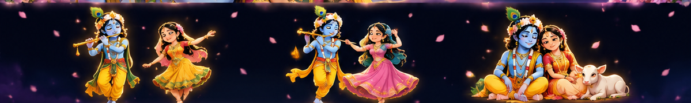

**🪷 AI/ML Developer · Research Enthusiast · Open Source Builder 🪷**

## 🌸 About Me

- 🎓 B.Tech in **Artificial Intelligence & Machine Learning** at Vignan University
- 🧠 Interested in **AI agents, deep learning, computer vision, RAG and geospatial AI**
- 🔬 Exploring **speckle-robust Sentinel-1 SAR change detection** for research
- 🛠️ Building applied AI systems and open-source tools
- 🎯 Goal: **Machine Learning Engineer**

## 💻 Tech Stack

## ✨ Featured AI/ML Projects

| Project | What it does | Source |
|---|---|---|
| 🧠 **KnowSure** | Multi-agent research and claim verification platform | [Research Agent](https://github.com/kanna857/research-agent) |
| 🤖 **JARVIS** | Multi-agent AI assistant with vision and memory | [P-JARVIUS](https://github.com/kanna857/p-jarvius) |
| 🌾 **Sky Crop Health** | Satellite vegetation monitoring and crop disease AI | [Sky Crop Health](https://github.com/kanna857/P-SKY-CROP-HEALTH) |
| 🔎 **RepoMind-X** | AI-powered repository investigation and code understanding | [RepoMind-X](https://github.com/kanna857/RepoMind-X) |

## 🌙 GitHub Analytics

## 🐍 Contribution Snake

<picture>
  <source media="(prefers-color-scheme: dark)" srcset="https://raw.githubusercontent.com/kanna857/kanna857/output/github-contribution-grid-snake-dark.svg" />
  
</picture>

The snake will appear after the GitHub Actions workflow runs successfully.

## 🌺 Connect

**राधे राधे 🪷 | Keep learning, keep creating.**

