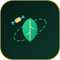

<div align="center">

<!-- ================= CINEMATIC HERO BANNER ================= -->
<picture>
  <source media="(prefers-color-scheme: dark)" srcset="./assets/hero-banner.svg" />
  <source media="(prefers-color-scheme: light)" srcset="./assets/hero-banner.svg" />
  
</picture>

<!-- Animated Title Header -->


<!-- ================= ANIMATED TYPING INTRODUCTION ================= -->


<p align="center">
  <b>🪷 A developer guided by devotion, driven by curiosity, and inspired by innovation. 🪷</b>
</p>

<!-- Golden Peacock Divider -->


<!-- ================= GLOWING KRISHNA FLUTE MUSIC BUTTON ================= -->
<a href="https://raw.githubusercontent.com/kanna857/kanna857/main/music/original-krishna-flute.mp3" title="Click to listen to the original Vrindavan Krishna Flute Melody">
  
</a>

<p align="center">
  <sub>🎵 <i>Original meditative Raag Bhupali bansuri melody synthesized for this repository. Tap the flute above to listen. No autoplay.</i></sub>
</p>

<!-- ================= ANIMATED DEVOTIONAL CHARACTER SECTION ================= -->
<table align="center" border="0" cellpadding="8" cellspacing="0" style="border: none; background: transparent;">
  <tr>
    <td align="center" width="33%" valign="top">
      
      <br />
      <b>🪈 Krishna's Melody</b>
      <br />
      <sub>Divine bansuri, rising musical notes & glowing mor pankh</sub>
    </td>
    <td align="center" width="33%" valign="top">
      
      <br />
      <b>🌸 Radha & Krishna</b>
      <br />
      <sub>Graceful pose, drifting lotus petals & sacred full moon</sub>
    </td>
    <td align="center" width="33%" valign="top">
      
      <br />
      <b>🪷 Vrindavan Lotus Garden</b>
      <br />
      <sub>Blooming Sahasrara lotuses, water ripples & fireflies</sub>
    </td>
  </tr>
</table>

<!-- Peacock Divider -->


</div>

<!-- ================= ABOUT ME SECTION ================= -->


```yaml
identity:
  name: Padma Dhanush
  role: Aspiring Machine Learning Engineer
  degree: B.Tech in Artificial Intelligence & Machine Learning
  institution: Vignan University
  focus: Multi-Agent Systems • Deep Learning • Computer Vision • Geospatial AI
  motto: "Code with Purpose. Create with Devotion."
```

> **Namaste!** I am an AI/ML developer passionate about engineering intelligent systems that bridge cutting-edge computational research with real-world impact. Guided by deep devotion and intellectual rigor, my exploration spans autonomous agent architectures, computer vision diagnostics, and remote sensing analytics.

- 🎓 **Undergraduate Scholar:** Pursuing B.Tech in Artificial Intelligence & Machine Learning at **Vignan University**.
- 🤖 **Multi-Agent Architectures:** Designing collaborative autonomous agent workflows with persistent memory and verifiable reasoning.
- 🛰️ **Geospatial & Remote Sensing AI:** Investigating speckle-noise-robust SAR (Synthetic Aperture Radar) change detection algorithms on Sentinel-1 data.
- 🔬 **Computer Vision & Deep Learning:** Developing robust vision models for medical imaging, precision agriculture, and visual scene understanding.
- 🌐 **Open Source & Research:** Actively building and contributing to open-source software, hackathons, and experimental AI tooling.

<div align="center">
  
</div>

<!-- ================= TECH ARSENAL SECTION ================= -->


<div align="center">

### 💻 Core Programming Languages


### 🧠 Artificial Intelligence, Machine Learning & Vision


### ⚡ Full Stack & Backend Infrastructure


### 🗄️ Databases & Developer Tooling


</div>

<div align="center">
  
</div>

<!-- ================= FEATURED PROJECTS SECTION ================= -->


<table align="center" width="100%" border="0" cellpadding="10" cellspacing="0">
  <tr>
    <td width="50%" valign="top">
      <table width="100%" style="border: 1px solid #F5C76B; border-radius: 12px; background: #080E26;">
        <tr>
          <td width="80" align="center" valign="middle">
            
          </td>
          <td>
            <h3 style="margin: 0; color: #F5C76B;">🧠 KnowSure</h3>
            <p style="color: #00D9C6; margin: 4px 0 8px 0; font-size: 13px;"><b>Multi-Agent Research & Evidence Verification</b></p>
            <p style="color: #C5CEE0; font-size: 12px; line-height: 1.5;">
              Autonomous multi-agent system capable of automated literature synthesis, rigorous fact-checking, claim contradiction detection, and uncertainty calibration.
            </p>
            <p style="margin: 6px 0 0 0;">
              <code>Python</code> • <code>FastAPI</code> • <code>Multi-Agent</code> • <code>NLP</code>
            </p>
            <p style="margin: 8px 0 0 0;">
              <a href="https://github.com/kanna857/research-agent"><b>🔗 Explore Repository →</b></a>
            </p>
          </td>
        </tr>
      </table>
    </td>
    <td width="50%" valign="top">
      <table width="100%" style="border: 1px solid #00D9C6; border-radius: 12px; background: #080E26;">
        <tr>
          <td width="80" align="center" valign="middle">
            
          </td>
          <td>
            <h3 style="margin: 0; color: #F5C76B;">🤖 JARVIS</h3>
            <p style="color: #00D9C6; margin: 4px 0 8px 0; font-size: 13px;"><b>Intelligent Multi-Agent Vision Assistant</b></p>
            <p style="color: #C5CEE0; font-size: 12px; line-height: 1.5;">
              Advanced AI assistant orchestrating domain-specialized agents with real-time computer vision capabilities, persistent vector memory, and automated task dispatching.
            </p>
            <p style="margin: 6px 0 0 0;">
              <code>Python</code> • <code>Computer Vision</code> • <code>Agents</code> • <code>Memory</code>
            </p>
            <p style="margin: 8px 0 0 0;">
              <a href="https://github.com/kanna857/p-jarvius"><b>🔗 Explore Repository →</b></a>
            </p>
          </td>
        </tr>
      </table>
    </td>
  </tr>
  <tr>
    <td width="50%" valign="top">
      <table width="100%" style="border: 1px solid #00D9C6; border-radius: 12px; background: #080E26;">
        <tr>
          <td width="80" align="center" valign="middle">
            
          </td>
          <td>
            <h3 style="margin: 0; color: #F5C76B;">🌾 Sky Crop Health</h3>
            <p style="color: #00D9C6; margin: 4px 0 8px 0; font-size: 13px;"><b>Satellite Remote Sensing & Crop Disease AI</b></p>
            <p style="color: #C5CEE0; font-size: 12px; line-height: 1.5;">
              Precision agricultural analytics platform leveraging multi-spectral satellite imagery, NDVI vegetation indices, and deep convolutional networks for early crop disease diagnosis.
            </p>
            <p style="margin: 6px 0 0 0;">
              <code>PyTorch</code> • <code>Remote Sensing</code> • <code>NDVI</code> • <code>CNN</code>
            </p>
            <p style="margin: 8px 0 0 0;">
              <a href="https://github.com/kanna857/P-SKY-CROP-HEALTH"><b>🔗 Explore Repository →</b></a>
            </p>
          </td>
        </tr>
      </table>
    </td>
    <td width="50%" valign="top">
      <table width="100%" style="border: 1px solid #F5C76B; border-radius: 12px; background: #080E26;">
        <tr>
          <td width="80" align="center" valign="middle">
            
          </td>
          <td>
            <h3 style="margin: 0; color: #F5C76B;">🔎 RepoMind-X</h3>
            <p style="color: #00D9C6; margin: 4px 0 8px 0; font-size: 13px;"><b>AI-Powered Codebase Intelligence Platform</b></p>
            <p style="color: #C5CEE0; font-size: 12px; line-height: 1.5;">
              Autonomous codebase investigator performing multi-agent architectural analysis, dependency tracing, semantic search, and intelligent bug patch synthesis.
            </p>
            <p style="margin: 6px 0 0 0;">
              <code>Python</code> • <code>AST Analysis</code> • <code>RAG</code> • <code>Agents</code>
            </p>
            <p style="margin: 8px 0 0 0;">
              <a href="https://github.com/kanna857/RepoMind-X"><b>🔗 Explore Repository →</b></a>
            </p>
          </td>
        </tr>
      </table>
    </td>
  </tr>
</table>

<div align="center">
  
</div>

<!-- ================= RESEARCH AND EXPLORATION ================= -->


<table align="center" width="100%" style="border: 1px solid #173A78; border-radius: 12px; background: #050A20; padding: 12px;">
  <tr>
    <td>
      <h4 style="color: #F5C76B; margin: 0 0 8px 0;">🛰️ Speckle-Robust SAR Satellite Change Detection</h4>
      <p style="color: #D1D5DB; font-size: 13px; line-height: 1.6; margin: 0 0 10px 0;">
        Investigating deep learning architectures for change detection in multi-temporal Synthetic Aperture Radar (SAR) imagery from Sentinel-1. Tackling multiplicative speckle noise through adaptive filtering and self-supervised feature representations.
      </p>
      <h4 style="color: #00D9C6; margin: 12px 0 8px 0;">🏥 Medical Image Diagnostics with Deep Learning</h4>
      <p style="color: #D1D5DB; font-size: 13px; line-height: 1.6; margin: 0 0 10px 0;">
        Experimenting with vision transformers (ViT) and convolutional networks for automated pathology classification, focusing on explainability, gradient class activation mapping (Grad-CAM), and model calibration under clinical distribution shift.
      </p>
      <h4 style="color: #A78BFA; margin: 12px 0 8px 0;">🤝 Multi-Agent Consensus & Contradiction Resolution</h4>
      <p style="color: #D1D5DB; font-size: 13px; line-height: 1.6; margin: 0;">
        Exploring debate-driven multi-agent protocols where specialized LLM agents peer-review evidence, cross-examine assertions, and quantify uncertainty to mitigate hallucination in automated research pipelines.
      </p>
    </td>
  </tr>
</table>

<div align="center">
  
</div>

<!-- ================= GITHUB STATS & CONSTELLATION ================= -->


<div align="center">

<table border="0" cellpadding="4" cellspacing="0">
  <tr>
    <td align="center">
      
    </td>
    <td align="center">
      
    </td>
  </tr>
</table>

<br />


### 🐍 Contribution Constellation Snake

<picture>
  <source media="(prefers-color-scheme: dark)" srcset="https://raw.githubusercontent.com/kanna857/kanna857/output/github-contribution-grid-snake-dark.svg" />
  <source media="(prefers-color-scheme: light)" srcset="https://raw.githubusercontent.com/kanna857/kanna857/output/github-contribution-grid-snake.svg" />
  
</picture>

<sub><i>The contribution snake is updated automatically every night via GitHub Actions.</i></sub>

</div>

<div align="center">
  
</div>

<!-- ================= ANIMATED DEVOTIONAL FOOTER ================= -->
<div align="center">



<br /><br />

[](https://github.com/kanna857)
[](https://github.com/kanna857)

<br />

```
================================================================================
             ॥ कृष्णाय वासुदेवाय हरये परमात्मने प्रणतक्लेशनाशाय गोविन्दाय नमो नमः ॥
          "Building Intelligent Systems with Devotion, Discipline & Curiosity"
================================================================================
```

</div>
